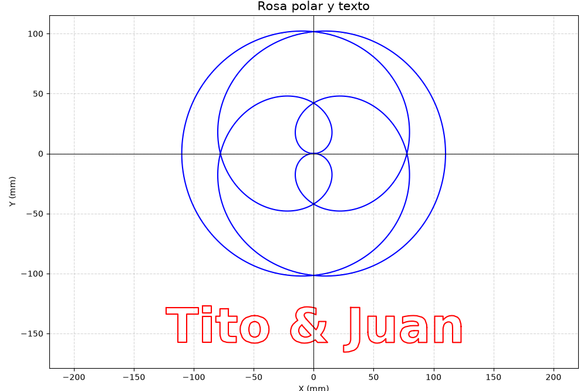

# Informe de Laboratorio 02

## Descripción de problema y solución

En los entornos modernos de manufactura flexible y automatización industrial, la selección, operación segura y programación eficiente de manipuladores robóticos requieren comprender tanto las capacidades mecánicas y cinemáticas de cada arquitectura como los entornos de simulación y control que permiten desplegar trayectorias complejas sin comprometer la integridad de los equipos.

Para abordar esta necesidad, en la presente práctica se realiza un análisis técnico comparativo entre dos manipuladores industriales de propósito general presentes en el laboratorio (**Yaskawa Motoman MH6** y **ABB IRB140**), se documentan las configuraciones iniciales de referencia (`home1` y `home2`), el protocolo de operación manual mediante el *Teach Pendant* (controlador **DX100**) y la arquitectura de software de **RoboDK** frente a **ABB RobotStudio**. Finalmente, como solución práctica de integración entre simulación y hardware real, se diseña y discretiza una trayectoria paramétrica basada en una curva de rosa polar $r(\theta) = \cos\left(\frac{n}{d}\theta\right)$ mediante la API de Python en RoboDK, validando su ejecución cinemática en el gemelo digital y comandando su trazado físico en tiempo real sobre el manipulador **Motoman MH6** desde el computador mediante comunicación TCP/IP.

## Tareas a desarrollar

### Comparación de especificaciones técnicas del Motoman MH6 y el IRB140 en un cuadro comparativo.

| Característica Técnica | ABB IRB140 | Yaskawa Motoman MH6 |
| :--- | :--- | :--- |
| **Peso del manipulador** | $\approx 98\text{ kg}$ ($\sim 90\text{ kg}$ nominal) | $\approx 130\text{ kg}$ |
| **Grados de libertad (GDL)** | 6 (8 en la celda del laboratorio con 2 ejes externos) | 6 (brazo base; extensible con ejes externos en celda) |
| **Alcance máximo** | $810\text{ mm}$ | $1422\text{ mm}$ |
| **Capacidad de carga (*Payload*)** | $6\text{ kg}$ | $6\text{ kg}$ |
| **Repetibilidad (ISO 9283)** | $\pm 0.03\text{ mm}$ | $\pm 0.08\text{ mm}$ |
| **Velocidad máxima articular / TCP** | TCP: hasta $2.5\text{ m/s}$<br>Articular: $200^\circ/\text{s}$ (Ejes 1-2), $260^\circ/\text{s}$ (Eje 3), $360^\circ/\text{s}$ (Ejes 4-5), $450^\circ/\text{s}$ (Eje 6) | Articular: $220^\circ/\text{s}$ (Eje S), $200^\circ/\text{s}$ (Eje L), $220^\circ/\text{s}$ (Eje U), $410^\circ/\text{s}$ (Ejes R, B), $610^\circ/\text{s}$ (Eje T) |
| **Controlador y lenguaje nativo** | IRC5 / RAPID | DX100 / INFORM III |
| **Año / Versión** | Lanzamiento serie ~2001 (Unidad reacondicionada en 2009) | Serie MH ~2008 (Controlador DX100) |
| **Aplicaciones típicas** | Ensamblaje de alta precisión, dispensado de adhesivos, soldadura por arco, limpieza/pulverización (IP67) y manipulación en celdas compactas | Manipulación de materiales (*Pick & Place*), atención de máquinas CNC (*Machine Tending*), soldadura, paletizado ligero y procesos de amplio volumen de trabajo |

### Describir las diferencias entre el home1 y el home2 del Motoman MH6.

- *home1* transporte: Posición pensada para transporte y reposo del robot, ocupando la menor cantidad de espacio posible, en posiciones que requieren el mínimo esfuerzo estático de componentes como los frenos electromagnéticos de los servomotores. En esta configuración plegada, el brazo se retrae sobre su base con valores articulares aproximados de $S = 0^\circ$, $L \approx -45^\circ$, $U \approx -65^\circ$, $R = 0^\circ$, $B \approx -25^\circ$, $T = 0^\circ$ *(ajustables según la variable de posición registrada en la celda del laboratorio)*.
- *home2* encoders en 0: Posición de calibración o punto de chequeo (*Second Home Position*) en la que los encoders absolutos de todos los motores del robot se encuentran en $0$ pulsos ($S = 0^\circ$, $L = 0^\circ$, $U = 0^\circ$, $R = 0^\circ$, $B = 0^\circ$, $T = 0^\circ$), coincidiendo exactamente con las marcas mecánicas de alineación grabadas en cada articulación (brazo inferior $L$ vertical y antebrazo $U$ extendido horizontalmente hacia adelante).

#### ¿Cuál posición es mejor? Justificación técnica

Desde el punto de vista operativo y de ingeniería mecánica, **ninguna sustituye por completo a la otra porque cumplen funciones distintas**, pero para la **operación cotidiana, estacionamiento al finalizar prácticas y preservación del hardware, `home1` es superior**:

- **Menor torque gravitacional y desgaste de frenos:** Al acercar el centro de masa del brazo y de la herramienta hacia el eje vertical de la base ($S$), `home1` reduce drásticamente el momento flector soportado por los reductores y frenos de los ejes $L$ y $U$ cuando el manipulador queda desenergizado.
- **Seguridad espacial y evasión de singularidades:** `home1` minimiza la envolvente física ocupada en la celda, reduciendo el riesgo de colisiones con periféricos o personal. Además, en `home2` ($B = 0^\circ$), los ejes de muñeca $R$ y $T$ quedan colineales, ubicando al manipulador en una **singularidad cinemática de muñeca** que impide iniciar directamente movimientos cartesianos suaves sin reorientar previamente el eje $B$.
- **Rol específico de `home2`:** `home2` sigue siendo indispensable únicamente como referencia metrológica para verificar la integridad de los encoders absolutos tras un corte de batería o colisión (mediante la rutina de comprobación de posición cero).

<!-- TODO: Subir fotos de las posiciones home -->

### Describir el procedimiento y cuáles teclas se usan para realizar el movimiento manual del manipulador Motoman por articulaciones, cambiar a movimientos cartesianos y realizar movimientos de traslación y rotación en los ejes X, Y, Z.

Para operar manualmente (*Jogging*) el manipulador Yaskawa Motoman MH6 desde el *Teach Pendant* del controlador **DX100**, se debe ejecutar el siguiente procedimiento secuencial:

#### 1. Habilitación del sistema y energización de servomotores
- **Verificación de seguridad:** Confirmar que los pulsadores tipo hongo de **Parada de Emergencia (*E-Stop*)** tanto en el panel frontal del controlador DX100 como en la esquina superior derecha del *Teach Pendant* se encuentren liberados (girados en sentido horario).
- **Selección del modo de operación (`TEACH`):** Girar la llave selectora ubicada en la parte superior izquierda del *Teach Pendant* hacia la posición **`TEACH`** (los otros dos estados disponibles son **`PLAY`** para ejecución automática de trabajos almacenados y **`REMOTE`** para control externo desde PLC o PC mediante RoboDK).
- **Preparación de servos:** Presionar el botón **`SERVO ON READY`** en el *Teach Pendant*; el LED indicador comenzará a parpadear señalando que el controlador está listo para energizar los motores.
- **Activación del interruptor de hombre muerto (*Enable Switch*):** Presionar y sostener en su posición intermedia el gatillo de seguridad de tres posiciones ubicado en la parte posterior del *Teach Pendant*. Al hacerlo, se cierran los contactores de potencia, se liberan los frenos mecánicos y el botón **`SERVO ON READY`** queda iluminado de forma continua. *(Nota: soltar el gatillo o presionarlo a fondo corta inmediatamente la energía de los servos por seguridad).*

#### 2. Cambio entre movimiento articular y movimientos cartesianos
- Presionar la tecla **`COORD`** ubicada en el panel central del *Teach Pendant*. Cada pulsación alterna cíclicamente entre los sistemas de coordenadas disponibles (mostrados en la barra superior de la pantalla):
  - **Coordenadas Articulares (`JOINT`):** Control individual de cada grado de libertad del manipulador.
  - **Coordenadas Cartesianas / Rectangulares (`RECT` / Base):** Desplazamiento lineal y rotación del *Tool Center Point* (TCP) respecto al sistema ortogonal fijo de la base del robot.
  - **Coordenadas de Herramienta (`TOOL`) y Usuario (`USER`):** Desplazamiento referido al marco local del efector final o a un plano de trabajo personalizado.

#### 3. Ejecución de movimientos en articulaciones, traslación y rotación ($X, Y, Z$)
Manteniendo presionado el gatillo trasero de habilitación, se utilizan las **12 teclas de movimiento de ejes** (6 pares negativo/positivo) situadas en la mitad derecha del *Teach Pendant*:

- **Movimiento por articulaciones (Modo `JOINT`):**
  - `[S-]` / `[S+]`: Giro de la base (*Swing*).
  - `[L-]` / `[L+]`: Inclinación del brazo inferior (*Lower Arm*).
  - `[U-]` / `[U+]`: Elevación/descenso del brazo superior (*Upper Arm*).
  - `[R-]` / `[R+]`: Rotación del antebrazo (*Wrist Roll*).
  - `[B-]` / `[B+]`: Cabeceo de la muñeca (*Wrist Bend*).
  - `[T-]` / `[T+]`: Giro de la brida de herramienta (*Wrist Twist*).
- **Movimiento cartesiano de traslación (Modos `RECT` / `TOOL` / `USER`):**
  - `[X-]` / `[X+]` *(teclas `S-`/`S+`)*: Desplazamiento lineal del TCP a lo largo del eje $X$.
  - `[Y-]` / `[Y+]` *(teclas `L-`/`L+`)*: Desplazamiento lineal del TCP a lo largo del eje $Y$.
  - `[Z-]` / `[Z+]` *(teclas `U-`/`U+`)*: Desplazamiento lineal del TCP a lo largo del eje $Z$.
- **Movimiento cartesiano de rotación (Modos `RECT` / `TOOL` / `USER`):**
  - `[Rx-]` / `[Rx+]` *(teclas `R-`/`R+`)*: Rotación pura del efector alrededor del eje $X$ manteniendo fija la posición $(X, Y, Z)$ del TCP.
  - `[Ry-]` / `[Ry+]` *(teclas `B-`/`B+`)*: Rotación pura del efector alrededor del eje $Y$ manteniendo fija la posición del TCP.
  - `[Rz-]` / `[Rz+]` *(teclas `T-`/`T+`)*: Rotación pura del efector alrededor del eje $Z$ manteniendo fija la posición del TCP.

<!-- TODO: Subir foto del teach pendant -->

### Detallar los niveles de velocidad del Motoman para movimientos manuales y su configuración, ¿Cómo se hace el cambio entre niveles de velocidad?, ¿Cómo se identifica en la pantalla el nivel de velocidad establecido?

#### Niveles de velocidad manual disponibles y configuración
En el controlador **Yaskawa DX100**, la velocidad de desplazamiento manual (*Manual Jog Speed*) está acotada normativamente (máximo $250\text{ mm/s}$ en modo `TEACH`) y se divide en **cuatro niveles discretos** preconfigurados en los parámetros del sistema:

- **Paso fino / Pulso (*Inching*):** Ejecuta un desplazamiento micrométrico discreto por cada pulsación de tecla de eje (sin movimiento continuo), utilizado para el posicionamiento fino de precisión junto a la pieza.
- **Bajo (*Low*):** Velocidad reducida (típicamente configurada alrededor del $1\% - 5\%$ de la velocidad máxima) para aproximaciones seguras en espacios restringidos.
- **Medio (*Medium*):** Velocidad intermedia (típicamente $\approx 10\% - 25\%$) para traslados generales de posicionamiento dentro de la celda.
- **Alto (*High*):** Velocidad máxima habilitada para operación manual en modo `TEACH` (hasta el $50\% - 100\%$ del límite seguro de enseñanza) para recorridos amplios libres de obstáculos.

#### Procedimiento para cambiar entre niveles de velocidad
El ajuste se realiza en tiempo real desde la sección **`MANUAL SPEED`** del *Teach Pendant* mediante dos teclas dedicadas:
- **`FAST`:** Incrementa en un escalón el nivel de velocidad manual cada vez que se presiona (de *Inching* $\rightarrow$ *Low* $\rightarrow$ *Medium* $\rightarrow$ *High*).
- **`SLOW`:** Reduce en un escalón el nivel de velocidad manual cada vez que se presiona (de *High* $\rightarrow$ *Medium* $\rightarrow$ *Low* $\rightarrow$ *Inching*).

#### Identificación visual en la pantalla del Teach Pendant
El nivel de velocidad activo se identifica en la **barra de estado superior** de la pantalla LCD del *Teach Pendant*, inmediatamente a la derecha del icono de coordenadas (`JOINT`/`RECT`), mediante un **icono escalonado de barras verticales crecientes** (de apariencia similar al indicador de intensidad de señal Wi-Fi):
- **Barra mínima / punto base:** Modo *Inching* (paso fino).
- **1 barra iluminada:** Velocidad Baja (*Low*).
- **2 barras iluminadas:** Velocidad Media (*Medium*).
- **3 barras iluminadas (icono completo):** Velocidad Alta (*High*).

### Explicar las aplicaciones principales de RoboDK y cómo se comunica con el manipulador, ¿Qué hace RoboDK para mover el manipulador?

#### Aplicaciones Principales de RoboDK

De acuerdo con la documentación oficial y el manual técnico de **RoboDK**, esta plataforma está diseñada como un entorno de **Programación Fuera de Línea (OLP - *Offline Programming*)** y simulación cinemática agnóstica al fabricante (con soporte para más de 900 manipuladores industriales y colaborativos de más de 50 marcas). Sus aplicaciones principales en ingeniería son:

- **Mecanizado Robótico (*Robot Machining*):** Conversión directa de trayectorias generadas en software CAM (código G, archivos APT o CL procedentes de Mastercam, Fusion 360, SolidWorks CAM, entre otros) en movimientos robóticos libres de singularidades y colisiones para fresado, desbarbado, pulido y corte.
- **Manufactura Aditiva (Impresión 3D Robótica):** Procesamiento de archivos *slicer* (G-code) para deposición de polímeros o metales, sincronizando la velocidad tangencial del *Tool Center Point* (TCP) con el flujo del extrusor.
- **Soldadura por Arco, Puntos y Dispensado (Pintura y Adhesivos):** Generación de cordones continuos sobre geometrías CAD complejas manteniendo orientaciones constantes de la antorcha o boquilla respecto a la superficie de trabajo.
- **Pick & Place, Paletizado y Atención de Máquinas (*Machine Tending*):** Automatización de celdas de manipulación con integración de sistemas de visión artificial, bandas transportadoras (*conveyors*) y ejes externos sincronizados (rieles lineales y posicionadores rotativos).
- **Calibración Cinemática e Inspección:** Identificación y compensación de errores geométricos mediante la actualización de los parámetros de **Denavit-Hartenberg (D-H)** usando sistemas de metrología externos (*laser trackers* o cámaras ópticas), elevando la precisión absoluta del manipulador conforme a la norma **ISO 9283**.
- **Desarrollo e Integración vía API:** Control programático y simulación integrada mediante librerías nativas en **Python, C++, C# y MATLAB**, permitiendo vincular algoritmos de planificación de trayectorias, visión por computador o aprendizaje automático directamente con el modelo cinemático.

---

#### Pipeline de Procesamiento: ¿Qué hace RoboDK para mover el manipulador?

Para lograr que un manipulador físico ejecute una trayectoria diseñada en el entorno virtual, RoboDK actúa como un puente entre la geometría CAD/CAM y el controlador industrial, ejecutando internamente el siguiente flujo matemático y de control:

1. **Definición de Marcos de Referencia (*Frames*) y Herramienta (*TCP*):**
   Establece las matrices de transformación homogénea ($T \in SE(3)$) entre la base del robot, el sistema de coordenadas de la pieza (*Reference Frame*) y el punto central de la herramienta (*Tool Frame*).
2. **Resolución de Cinemática Directa e Inversa (FK / IK):**
   Calcula el vector de coordenadas articulares necesarias $\mathbf{q} = [q_1, q_2, \dots, q_n]^T$ para alcanzar cada pose cartesiana deseada $\mathbf{x} = [X, Y, Z, R_x, R_y, R_z]^T$. Durante este proceso, evalúa las múltiples soluciones de configuración (codo arriba/abajo, muñeca invertida/no invertida), verifica los límites mecánicos de cada eje y detecta la proximidad a **singularidades cinemáticas** (donde $\det(J(\mathbf{q})) \approx 0$).
3. **Planificación e Interpolación de Trayectorias:**
   Discretiza el recorrido según el tipo de movimiento programado:
   - `MoveJ`: Interpolación en el espacio articular (trayectoria curva en el espacio cartesiano, óptima para desplazamientos rápidos sin restricciones de ruta).
   - `MoveL`: Interpolación lineal en el espacio cartesiano manteniendo orientación controlada del TCP.
   - `MoveC`: Interpolación circular definida mediante puntos de paso y destino.
   - Adicionalmente, aplica parámetros de suavizado de esquinas (*Rounding / Blending*) y verifica colisiones geométricas en toda la estación.
4. **Traducción mediante Post-Procesadores (*Post-Processors*):**
   Internamente, RoboDK almacena las estaciones y trayectorias como scripts genéricos en Python. Al exportar, un **post-procesador** específico traduce cada comando abstracto a la sintaxis, estructura de archivos y dialecto exacto del controlador destino (por ejemplo, `MoveL` en RAPID para ABB, `LIN` en KRL para KUKA, `MOVL` en Inform/JBI para Yaskawa Motoman o `movel()` en URScript para Universal Robots).
5. **Despacho al Controlador Físico:**
   Envía el programa compilado hacia la memoria del controlador o transmite las consignas de posición paso a paso mediante un *driver* de red para que los lazos servo del fabricante ejecuten el movimiento físico.

---

### ¿Cómo se comunica RoboDK con el manipulador?

Según la documentación técnica de **RoboDK Drivers** y los manuales de integración de controladores, la comunicación entre la estación de trabajo donde corre RoboDK y el controlador físico del robot se realiza mediante **dos paradigmas operativos** y una capa de integración industrial:

#### 1. Comunicación Offline (Transferencia de Programas Compilados)

En este modo, RoboDK no interviene durante la ejecución en tiempo real; opera como generador de código fuente nativo:

- **Generación de Código:** El post-procesador compila los archivos ejecutables específicos del fabricante (ej. módulos `.mod` y `.prg` para ABB, `.src` y `.dat` para KUKA, `.ls`/`.tp` para Fanuc, `.jbi` para Yaskawa Motoman).
- **Protocolos de Transferencia:** Los archivos se transfieren al controlador a través de **FTP / SFTP** mediante la red Ethernet industrial, carpetas compartidas en red o medios físicos (USB) conectados al *Teach Pendant*.
- **Ejecución Autónoma:** El controlador del robot interpreta y ejecuta el programa de forma completamente independiente de la computadora.

#### 2. Comunicación Online / Tiempo Real (*RoboDK Drivers* - "Run on Robot")

Permite comandar y monitorear el manipulador físico directamente desde la interfaz gráfica o la API de RoboDK mediante una arquitectura **Cliente-Servidor sobre TCP/IP (Sockets Ethernet)**:

```text
+-----------------------------------+                     +---------------------------------------+
|          PC (RoboDK)              |   TCP/IP Sockets    |       Controlador del Robot           |
|                                   |  (Ethernet / LAN)   |                                       |
|  - Cinemática Inversa (IK)        | ==================> |  - Script Servidor Nativo (RAPID/KRL) |
|  - Planificador / API Python      |   Consignas (q / x) |  - Parser de tramas de movimiento     |
|  - Gemelo Digital Sincronizado    | <================== |  - Planificador de movimiento interno |
|                                   |  Feedback (q_real)  |  - Lazos Servo de Articulaciones      |
+-----------------------------------+                     +---------------------------------------+
```

- **Lado Servidor (Controlador del Robot):** Se carga previamente un programa servidor escrito en el lenguaje nativo del fabricante (por ejemplo, el módulo servidor en RAPID para ABB utilizando la opción *PC Interface / Socket Messaging*, o el servidor MotoPlus/INFORM en Yaskawa Motoman). Este script abre un socket TCP y permanece en escucha activa en un puerto determinado.
- **Lado Cliente (RoboDK Driver):** Un ejecutable independiente gestionado por RoboDK establece conexión TCP/IP con la dirección IP del controlador. Envía tramas de datos con consignas de posición articular ($\mathbf{q}$), poses cartesianas ($\mathbf{x}$), velocidades del TCP, radios de redondeo y estados de salidas digitales/analógicas (`SetDO` / `SetAO`).
- **Bucle de Retroalimentación (*Feedback*):** El controlador ejecuta cada instrucción recibida y devuelve continuamente a RoboDK el vector de ángulos articulares reales leídos desde los *encoders* y el estado operativo (*Busy / Ready*), manteniendo sincronizado el gemelo digital con el robot físico.

> **Nota técnica de ingeniería:** El modo *Online* mediante *drivers* de sockets está orientado a pruebas de validación, depuración de trayectorias y aplicaciones guiadas por visión o sensores no críticas en determinismo duro, dado que la latencia de red TCP/IP y la ejecución instrucción por instrucción limitan el *blending* continuo de alta velocidad en comparación con la ejecución nativa *Offline*.

#### 3. Integración con Protocolos Industriales y APIs Externas

Para celdas automatizadas complejas, RoboDK se comunica con periféricos y controladores lógicos programables (PLC) mediante:

- **API de RoboDK (Python / C++ / C# / MATLAB):** Actúa como concentrador de datos que lee sensores externos, cámaras o bases de datos y envía actualizaciones dinámicas de trayectoria al robot.
- **Buses de Campo y Middleware:** Integración indirecta o mediante nodos puente con **OPC UA**, **Modbus TCP** y **ROS / ROS2** para sincronización con sistemas SCADA o arquitecturas distribuidas.

---

### Analizar las diferencias entre RoboDK y RobotStudio y describir los usos específicos de cada herramienta, ¿Qué significa para usted cada una de esas herramientas?

#### Matriz Comparativa Técnica: RoboDK vs. ABB RobotStudio

| Característica Técnica | RoboDK | ABB RobotStudio |
| :--- | :--- | :--- |
| **Alcance de Fabricantes** | **Multimarca (Agnóstico):** Más de 900 robots de más de 50 fabricantes (ABB, KUKA, Fanuc, UR, Yaskawa, etc.). | **Exclusivo ABB:** Toda la gama de manipuladores ABB (IRB, GoFa, YuMi, IRB 360 FlexPicker, etc.). |
| **Motor de Simulación** | **Modelado Cinemático Geométrico:** Resuelve IK/FK mediante algoritmos propios y traduce vía post-procesadores. | **Virtual Robot Controller (VRC / VirtualRobot™):** Ejecuta una instancia exacta del firmware real (**RobotWare**). |
| **Fidelidad de Tiempo de Ciclo** | Aproximada (basada en perfiles cinemáticos teóricos de velocidad y aceleración). | **Exacta (Determinista):** Tiempos de ciclo reales idénticos al controlador físico IRC5 u OmniCore. |
| **Lenguaje de Programación** | Interfaz gráfica, Python, C++, C#, MATLAB (traducido al lenguaje destino al exportar). | **Nativo RAPID:** Edición, compilación y depuración directa de código RAPID y *FlexPendant* virtual. |
| **Integración CAD / CAM** | Muy alta y nativa para mecanizado (conversión directa de G-code/APT a trayectorias). | Alta para diseño de estaciones CAD; requiere *PowerPacs* específicos para mecanizado o soldadura. |
| **Lógica de Controlador e I/O** | Simulación básica de eventos y señales I/O mediante scripts Python o GUI. | Simulación completa de multitarea, interrupciones (`TRAP`), buses de campo (PROFINET, EtherNet/IP) y *Smart Components*. |
| **Seguridad Funcional** | Verificación geométrica de colisiones y zonas de trabajo. | Configuración y validación real de **SafeMove** (zonas seguras, supervisión de velocidad y parada segura). |

---

#### Análisis de Diferencias Arquitectónicas

1. **Emulación del Controlador Real vs. Traducción por Post-Procesador:**
   Esta es la diferencia fundamental desde la ingeniería de control. **RobotStudio** no solo simula la geometría del brazo; ejecuta internamente el mismo software de control (**RobotWare**) que opera dentro del gabinete físico del robot ABB. Esto garantiza que la planificación dinámica, los límites de par/corriente, las zonas de suavizado (`z10`, `fine`), las interrupciones en tiempo real y los errores de ejecución sean idénticos a los de planta. Por su parte, **RoboDK** calcula la trayectoria en su motor cinemático propio y la traduce mediante un post-procesador; si el controlador físico posee restricciones dinámicas particulares o configuraciones específicas de sistema, pueden surgir ligeras desviaciones entre la simulación y la ejecución real.
2. **Flexibilidad Heterogénea vs. Profundidad Monomarca:**
   RoboDK abstrae las diferencias entre fabricantes permitiendo programar una célula híbrida (por ejemplo, un robot KUKA alimentando a un robot ABB) desde un único entorno y bajo una misma API en Python. RobotStudio está optimizado verticalmente para el ecosistema ABB, permitiendo configurar parámetros de bajo nivel del controlador (`MOC.cfg`, `EIO.cfg`, `SYS.cfg`) inaccesibles desde herramientas genéricas.
3. **Ecosistema CAD/CAM vs. Ingeniería de Célula Industrial:**
   RoboDK incorpora nativamente algoritmos de optimización de ejes redundantes (como la rotación libre alrededor del eje $Z$ de la herramienta en fresado o impresión 3D) directamente desde archivos CAM. RobotStudio requiere módulos adicionales (*Machining PowerPac*, *ArcWelding PowerPac*), pero supera ampliamente a RoboDK en la simulación física de periféricos complejos mediante **Smart Components** (sensores, actuadores neumáticos, lógica de enclavamiento) y en la sincronización exacta de múltiples manipuladores (**MultiMove**).

---

#### Usos Específicos de Cada Herramienta

##### Usos Específicos de RoboDK

- **Manufactura Avanzada desde CAD/CAM:** Fresado robótico en materiales compuestos, madera o aluminio, corte por plasma/láser e impresión 3D de gran formato.
- **Células Multimarca e Investigación y Desarrollo (I+D):** Laboratorios de robótica, universidades e integradores que trabajan con flotas mixtas de robots y desarrollan algoritmos personalizados en Python, C++ o MATLAB.
- **Calibración de Precisión:** Proyectos donde se requiere compensar la deflexión y tolerancias mecánicas de un robot industrial mediante metrología externa para tareas de alta exactitud.
- **Estudios Preliminares de Viabilidad (*Reachability Studies*):** Selección rápida del modelo y marca de robot adecuado antes de adquirir el hardware.

##### Usos Específicos de ABB RobotStudio

- **Puesta en Marcha Virtual (*Virtual Commissioning*):** Validación integral de líneas de producción automotriz o manufactura pesada con robots ABB antes de instalar los equipos en fábrica, reduciendo drásticamente los tiempos de paro en planta.
- **Validación Estricta de *Takt Time*:** Cálculo exacto de tiempos de ciclo donde diferencias de décimas de segundo impactan la productividad de la línea.
- **Programación Avanzada en RAPID y Comunicaciones Industriales:** Desarrollo de arquitecturas multitarea en RAPID, comunicación con PLCs maestros mediante PROFINET/EtherNet/IP, manejo de excepciones y lógica de recuperación de fallos.
- **Sistemas Críticos de Seguridad y Sincronización:** Configuración certificada de **ABB SafeMove** para celdas colaborativas sin vallado físico y programación de sistemas **MultiMove** (múltiples robots operando de forma coordinada sobre una misma pieza en movimiento).

---

#### Significado personal

Desde la perspectiva de un ingeniero mecatrónico especialista en robótica, ambas herramientas representan dos niveles complementarios dentro del ciclo de vida de un sistema automatizado:

- **RoboDK significa interoperabilidad, agilidad y abstracción de alto nivel:** Es el puente ideal entre el diseño mecánico (CAD/CAM), la teoría de control/cinemática y el despliegue rápido sobre hardware heterogéneo. Permite concentrarse en la planificación geométrica, la integración de sensores mediante lenguajes modernos (Python/C++) y la validación conceptual sin quedar atado a la sintaxis propietaria de un único fabricante.
- **ABB RobotStudio significa determinismo, fidelidad de hardware y rigor industrial (*Digital Twin* verdadero):** Representa la ingeniería de detalle y la puesta en marcha virtual de grado productivo. Cuando un proyecto en planta utiliza infraestructura ABB, RobotStudio garantiza que el código RAPID, las configuraciones de seguridad funcional, los tiempos de ciclo y las comunicaciones de campo funcionarán exactamente igual en el controlador físico que en el entorno virtual, mitigando riesgos mecánicos, eléctricos y operativos antes de energizar el manipulador.

### Programar una trayectoria polar en RoboDK, hacer que se ejecute virtualmente en RoboDK y hacer que el manipulador Motoman la realice físicamente comandado desde el PC. https://www.monografias.com/trabajos33/coordenadas-polares/coordenadas-polares.

#### Formulación Matemática y Discretización de la Trayectoria

Para el trazado planar sobre la superficie de trabajo mediante el manipulador **Yaskawa Motoman MH6**, se emplea la ecuación paramétrica de la rosa polar escalada por una amplitud máxima $A$ (en milímetros):

$$r(\theta) = A \cos\left(\frac{n}{d} \cdot \theta\right)$$

Donde:
- $A$: Radio máximo de la figura dentro de la zona segura de dibujo (definido en milímetros).
- $n, d \in \mathbb{Z}^+$: Parámetros enteros coprimos que determinan el número de pétalos y el periodo angular $\Theta_{\max} = 2\pi d$ necesario para cerrar completamente la curva.
- $\theta \in [0, \Theta_{\max}]$: Ángulo polar discretizado en $N$ pasos uniformes $\Delta\theta = \frac{\Theta_{\max}}{N}$.

La conversión de coordenadas polares $(r, \theta)$ a coordenadas cartesianas $(x, y, z)$ referidas al marco de trabajo del plano (*Reference Frame*) se realiza mediante:

$$x(\theta) = r(\theta)\cos(\theta), \quad y(\theta) = r(\theta)\sin(\theta), \quad z(\theta) = 0$$

#### Implementación en RoboDK y Ejecución Física

1. **Configuración de la estación virtual:** Se carga el modelo cinemático del **Yaskawa Motoman MH6**, se calibra el *Tool Center Point* (TCP) correspondiente al porta-marcador/herramienta y se define el sistema de referencia del plano de trabajo verificando que todos los puntos estén libres de colisiones y singularidades.
2. **Generación programática vía API de Python (`robodk`):**
   - El manipulador parte desde una posición segura de aproximación sobre el origen $(0, 0, z_{\text{seguro}})$ mediante un movimiento articular (`MoveJ`).
   - Desciende perpendicularmente hasta el punto inicial de la curva $(x(0), y(0), 0)$ con orientación constante normal al plano ($R_x = 180^\circ, R_y = 0^\circ, R_z = 0^\circ$).
   - Recorre secuencialmente los $N$ puntos discretizados aplicando interpolación lineal cartesiana (`MoveL`) para garantizar fidelidad geométrica en el trazado.
   - Al completar el periodo $\Theta_{\max}$, eleva la herramienta a $z_{\text{seguro}}$ y retorna a la posición de reposo.
3. **Ejecución en el manipulador físico:**
   - Se coloca el selector de llave del controlador **DX100** en modo **`REMOTE`**.
   - En RoboDK se configura la conexión Ethernet (dirección IP del controlador Motoman y puerto del *driver* `apikuka`/`motoman`), se verifica el estado *Ready* y se habilita la opción **"Ejecutar en el robot" (*Run on Robot*)** para comandar los movimientos en tiempo real desde el PC.

### Bajo la sección de la trayectoria polar, incluir los nombres de los integrantes del equipo.

#### Integrantes del Equipo

- **[Nombre Completo Integrante 1]**
- **[Nombre Completo Integrante 2]**

## Resultado



### Video
